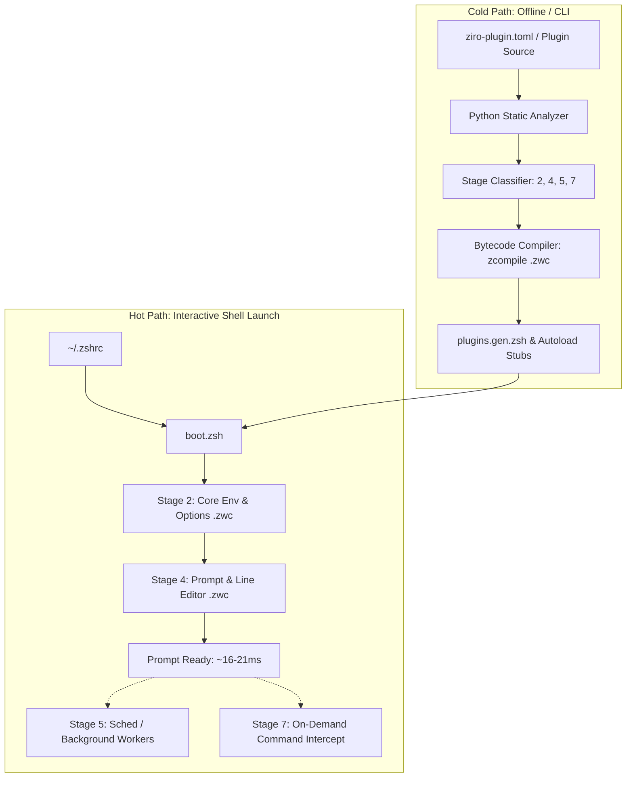

# ziro-shell

<!-- S1: Animated Logo -->
<p align="center">
  <svg width="400" height="400" viewBox="0 0 400 400" xmlns="http://www.w3.org/2000/svg" role="img" aria-label="Ziro runtime orbital architecture">
    <style>
      @media (prefers-reduced-motion: reduce) {
        .orbit-eager, .orbit-deferred, .orbit-demand { animation: none !important; }
      }
      .orbit-line { fill: none; stroke: #313244; stroke-width: 1.5; stroke-dasharray: 4 4; }
      .sun { fill: #1e1e2e; stroke: #cdd6f4; stroke-width: 2.5; }
      .sun-z { fill: #f5f5f5; font-family: monospace, monospace; font-size: 42px; font-weight: bold; text-anchor: middle; dominant-baseline: central; }
      .orbit-eager { transform-origin: 200px 200px; animation: spin 6s linear infinite; }
      .orbit-deferred { transform-origin: 200px 200px; animation: spin 12s linear infinite; }
      .orbit-demand { transform-origin: 200px 200px; animation: spin 20s linear infinite; }
      .dot-eager { fill: #f5c2e7; }
      .dot-deferred { fill: #89b4fa; }
      .dot-demand { fill: #a6e3a1; }
      @keyframes spin { from { transform: rotate(0deg); } to { transform: rotate(360deg); } }
    </style>
    <rect width="100%" height="100%" fill="#181825" rx="20"/>
    <circle cx="200" cy="200" r="80" class="orbit-line"/>
    <circle cx="200" cy="200" r="140" class="orbit-line"/>
    <circle cx="200" cy="200" r="180" class="orbit-line"/>
    <g class="orbit-eager"><circle cx="200" cy="120" r="6" class="dot-eager"/><circle cx="200" cy="280" r="6" class="dot-eager"/></g>
    <g class="orbit-deferred"><circle cx="200" cy="60" r="7" class="dot-deferred"/><circle cx="78" cy="270" r="7" class="dot-deferred"/><circle cx="322" cy="270" r="7" class="dot-deferred"/></g>
    <g class="orbit-demand"><circle cx="200" cy="20" r="8" class="dot-demand"/><circle cx="200" cy="380" r="8" class="dot-demand"/></g>
    <circle cx="200" cy="200" r="38" class="sun"/>
    <text x="200" y="202" class="sun-z">Z</text>
  </svg>
</p>

<!-- S2: Badges, Tagline & Mini-TOC -->
<p align="center">
  <a href="https://github.com/Pakrohk/ziro-shell/actions"></a>
  <a href="https://www.python.org/"></a>
  <a href="https://www.zsh.org/"></a>
  <a href="LICENSE"></a>
  <a href="https://github.com/Pakrohk/ziro-shell/releases"></a>
  <a href="tests/"></a>
</p>

<h3 align="center">The intent-oriented Zsh</h3>
<p align="center"><em>Analyzed. Compiled. Lazy.</em></p>

<p align="center">
  <a href="#installation">Install</a> ·
  <a href="#features">Features</a> ·
  <a href="#how-it-works">How It Works</a> ·
  <a href="#plugin-development">Plugin Development</a> ·
  <a href="#contributing">Contributing</a> ·
  <a href="#documentation">Documentation</a>
</p>

---

## What is Ziro?

Ziro is an intent-oriented Zsh runtime: every plugin is analyzed at install time, compiled to bytecode, and materialized only when needed.

- **Analyze (Cold Path)**: Python-based static inspection resolves shell hooks, completion functions, aliases, and dependencies out-of-band.
- **Compile (`.zwc`)**: Sourced files and functions are pre-compiled into native Zsh wordcode (`.zwc`), bypassing tokenization on shell startup.
- **Lazy (On-Demand)**: A deterministic 4-tier scheduler defers execution so non-essential components materialize post-prompt or on invocation.

Measured baseline: **~16-21ms startup** (compinit sync floor: ~6.75ms / 67% of startup), **27 pre-configured tools**, and **434 passing tests**. Ziro is an execution runtime enforcing lifecycle isolation, cache coherence, and deterministic scheduling.

---

## Why Ziro Exists

### The Problem

Standard Zsh setups scale linearly into latency degradation. Sourcing 15 to 30 plugins routinely incurs 100-300ms startup latency. Traditional workarounds introduce defects:
- **Instant prompts**: Render temporary overlays while initialization runs asynchronously, causing missed keystrokes and cursor glitches.
- **Indiscriminate deferral**: Deferring all plugin sourcing breaks line-editor bindings, command completions, and hook execution.

### The Insight & 4-Tier Model

Plugin requirements are predictable at install time. Compiling scripts to `.zwc` wordcode eliminates repetitive parsing, and on-demand loading isolates tool initialization to trigger events.

```text
+-----------------------------------------------------------+
| Stage 2: Eager (Core Environment & Options)              |
+-----------------------------------------------------------+
                              |
+-----------------------------------------------------------+
| Stage 4: Eager (Interactive Prompt & ZLE Baseline)        |
+-----------------------------------------------------------+
                              | [First Prompt Displayed: ~16-21ms]
+-----------------------------------------------------------+
| Stage 5: Deferred (Idle Scheduler / Background Sourcing)  |
+-----------------------------------------------------------+
                              |
+-----------------------------------------------------------+
| Stage 7: On-Demand (Function Autoloads & Traps)           |
+-----------------------------------------------------------+
```

| Stage | Tier | Timing | Component Types |
|---|---|---|---|
| **2** | Eager | Synchronous pre-prompt | Environment variables, path definitions, core options |
| **4** | Eager | Synchronous pre-prompt | Line editor baseline, Starship prompt initialization |
| **5** | Deferred | Post-prompt via `sched` | Syntax highlighting hooks, diagnostic telemetry, git status |
| **7** | On-Demand | Command execution | Tool completions, function autoload stubs, heavy CLI integrations |

### Compiled-Only Rule & Non-Goals

Ziro enforces a strict compiled-only rule: execution paths require fresh `.zwc` bytecode files. If a compiled artifact is missing, the cold-path engine re-compiles it rather than falling back to uncompiled `.zsh` parsing.

**What Ziro is NOT**:
- **Not an Oh My Zsh replacement**: Ziro does not ship hundreds of arbitrary functions or legacy aliases.
- **Not zero-dependency**: Cold-path analysis requires Python 3.11+. The interactive hot path runs strictly in native Zsh.
- **Not an unvalidated script runner**: Plugins without manifests or passing analysis are treated as unknown risks.

---

## Installation

### Prerequisites

- **Zsh**: 5.8+ · **Python**: 3.11+ (standard library only; cold-path only) · **Git**: 2.25+ · **OS**: Linux or macOS

### Quick Install

```bash
curl -fsSL https://raw.githubusercontent.com/Pakrohk/ziro-shell/main/install.sh | bash
```

### Manual Git Clone

```bash
git clone https://github.com/Pakrohk/ziro-shell.git ~/.ziro
cd ~/.ziro && ./install.sh --default
```

Append the bootstrap entrypoint to your `~/.zshrc`:

```zsh
source ~/.config/ziro/boot.zsh
```

Verify runtime health and artifacts: `ziro doctor && ziro analyze && ziro sync`. For existing framework migration, see [docs/MIGRATION.md](docs/MIGRATION.md).

---

## Features

### Analyzed. Compiled. Lazy.

- **Analyzed (Cold Path)**: The offline analyzer inspects ZLE widgets, options, hooks, and completions to generate deterministic loading plans without runtime heuristics.
- **Compiled (Hot Path)**: Managed scripts and completion files are pre-compiled to `.zwc` wordcode, eliminating parsing overhead and disk I/O on startup.
- **Lazy (On-Demand)**: Tools remain dormant until invoked via autoload wrappers that intercept command execution.
- **Batteries Included (27 Tools)**: Pre-configured integrations for `starship`, `zoxide`, `fzf`, `fzf-tab`, `zsh-completions`, `fast-syntax-highlighting`, `ziro-ghost`, `eza`, `bat`, `ripgrep`, `fd`, `git`, and core navigation.
- **Observable**: `ziro doctor` audits health and symlinks; `ziro analyze` inspects classifications; `ziro bench` tracks startup metrics.

### Benchmark Data

Measured under standardized conditions (100 iterations, warm disk cache):

| Metric | Measured Value | Notes |
|---|---|---|
| **Startup time** | 16-21 ms | Baseline includes Starship prompt + full completion engine |
| **Compinit sync floor** | 6.75 ms | Constitutes ~67% of total startup overhead |
| **First command lag** | 19.93 ms | Latency to execute first command in interactive shell |
| **Input lag** | 0.18 ms | ZLE keypress response time |
| **Exit time** | 20.57 ms | Cleanup and trap execution overhead |

#### Bytecode (`.zwc`) Gains

| Extension / Component | Uncompiled Source | Compiled `.zwc` | Latency Reduction |
|---|---|---|---|
| `starship` init | 3.39 ms | 1.60 ms | -52.8% |
| `zcolors` | 2.63 ms | 1.11 ms | -57.8% |
| `git` core integration | 5.74 ms | 5.03 ms | -12.4% |

For evaluation methodology, see [docs/BENCHMARKS.md](docs/BENCHMARKS.md).

---

## How It Works



1. **Cold Path (Out-of-band)**: Invoked during `ziro sync` or updates. Python extracts symbols, hooks, and dependencies, compiling `.zwc` artifacts and writing static dispatch tables.
2. **Hot Path (Runtime)**: Executes synchronously inside `boot.zsh`. Sourcing is restricted to compiled bytecodes for Stages 2 and 4. Stage 5 initializes via Zsh `sched` queues; Stage 7 uses autoload trampolines. See [docs/ARCHITECTURE.md](docs/ARCHITECTURE.md).

---

## Plugin Development

Ziro supports unannotated legacy plugins (heuristically assigned to stage 5 or 7) and manifest-aware plugins conforming to **Spec 012**:

```toml
# ziro-plugin.toml (Spec 012)
[plugin]
name = "example-tool"
version = "1.0.0"
description = "Deterministic utility wrapper"

[runtime]
stage = 5
autoload_functions = ["example_cmd"]
bin_paths = ["bin"]
dependencies = ["fzf"]

[hooks]
precmd = "_example_precmd_hook"
```

### Local Testing and Publishing

```bash
ziro plugin add --path ./my-plugin
ziro analyze my-plugin
ziro sync
```

Consult [docs/PLUGIN_AUTHORING.md](docs/PLUGIN_AUTHORING.md) for full manifest specifications and publishing guidelines.

---

## Contributing

We welcome technical contributions that advance runtime efficiency, expand test coverage, and verify platform portability.

### Ways to Contribute

| Area | Focus | Primary Artifacts |
|---|---|---|
| **Core Runtime** | Shell lifecycle, scheduler optimization, and boot sequences | `core/*.zsh`, `lib/*.zsh` |
| **Plugin Manifests** | Spec 012 declarations for ecosystem tools | `plugins/**/ziro-plugin.toml` |
| **Static Analyzer** | Python cold-path AST classification and hook detection | `core/analyzer.py`, `core/build.py` |
| **Platform Verification** | Portability across Arch, Ubuntu, Fedora, Alpine, macOS | CI matrix, test containers |
| **Test Suites** | Unit, contract, and hermetic integration tests | `tests/`, `pytest` |
| **Benchmarks** | Reproductions, regression tracking, and timing audits | `docs/BENCHMARKS.md` |
| **Documentation** | Technical guides, specifications, and architecture records | `docs/*.md` |
| **Bug Triage** | Reproductions, diagnostic traces, and root-cause fixes | Issue tracker, `ziro doctor` |

### Development Setup & Standards (ADR-009)

```bash
git clone https://github.com/Pakrohk/ziro-shell.git ~/Projects/ziro-shell
ln -sfn ~/Projects/ziro-shell ~/.ziro
```

> **Warning**: `~/.ziro` informs your active shell runtime. Avoid unverified destructive operations in `~/Projects/ziro-shell` without a configuration backup.

- **POSIX Shell Core (`bin/*`, `lib/*.sh`)**: Standard POSIX parameter expansion (`${var:-default}`); no subshells in performance loops; early functional returns.
- **Zsh Hot Path (`*.zsh`, `plugins/**/*.zsh`)**: Associative array dispatch (`typeset -A`); Zsh glob qualifiers `*(.)`; strict script idempotency.
- **Python Cold Path (`core/*.py`)**: Python 3.11+ standard library only (`tomllib`, `typing`, `pathlib`); strict type annotations; zero third-party dependencies.

### Testing, PR Process & Disclosure

- **Test Suite**: All 434 tests must pass without regressions: `PYTHONPATH=. uv run --with pytest pytest tests/ -q`.
- **Performance Budget**: Hot-path modifications carry a strict budget constraint: startup latency increase must remain `< +5ms`.
- **Pull Requests**: Open an issue first for non-trivial changes. Submit minimal PRs accompanied by raw benchmark traces (H7 evidence rule).
- **Security Disclosure**: Report vulnerabilities privately via GitHub Security Advisories or email maintainers at `pakrohk-security@pm.me`. See [CODE_OF_CONDUCT.md](CODE_OF_CONDUCT.md) and [CONTRIBUTORS.md](CONTRIBUTORS.md). Full guide in [docs/CONTRIBUTING.md](docs/CONTRIBUTING.md).

---

## Documentation

Comprehensive guides and architectural specifications:

- **[Architecture](docs/ARCHITECTURE.md)** — 4-tier load model, boot chain, analyzer, and security heuristic.
- **[Configuration](docs/CONFIGURATION.md)** — `load.toml` schema, `[user]` overrides, and per-tool fields.
- **[Plugin Authoring](docs/PLUGIN_AUTHORING.md)** — `ziro-plugin.toml` manifest specification, testing, and publishing.
- **[Defer](docs/DEFER.md)** — 8-stage scheduler, priority slots, and dependency resolution.
- **[Declarative](docs/DECLARATIVE.md)** — Spec 012 manifest philosophy and IOP design foundation.
- **[Migration](docs/MIGRATION.md)** — Migration guides from Oh My Zsh, Prezto, Zinit, and Zim.
- **[Benchmarks](docs/BENCHMARKS.md)** — Measurement methodology, containerized isolation, and metrics.
- **[Contributing](docs/CONTRIBUTING.md)** — Extended contributor handbook, testing matrix, and ADR process.

---

## Roadmap

| Version | Milestone | Status | Scope |
|---|---|---|---|
| **v1.2.0** | Stable Runtime Core | Released | Bytecode compilation pipeline, 4-tier scheduler, 27 tool profiles, 434 tests |
| **v1.3.0** | Cache Persistence | Planned | Persistent pre-computed shell state cache, incremental analyzer invalidation |
| **v1.4.0** | Package Federation (`pf`) | Planned | Standalone cross-distro package manager dispatch (Spec 010) |
| **v2.0.0** | Ghost Engine v2 | Design Complete | Deep ZLE integration (Spec 009) with asynchronous ghost-text completions |

---

## Acknowledgments

- **EVOID by EvolveBeyond**: Conceptual inspiration for intent-driven systems architecture.
- **zsh-snap (`znap`)**: Early research on shell bytecode compilation and repository management.
- **zsh-bench**: Benchmark methodology and timing standardization tooling.
- **OMZ & zsh-users**: Foundation work across shell completions, highlighting, and autosuggestions.

---

## License

This project is licensed under the [MIT License](LICENSE). See [Contributing](#contributing) for guidelines.
