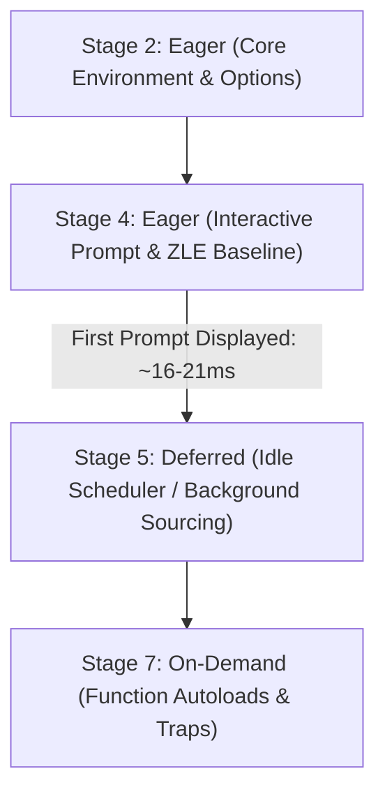
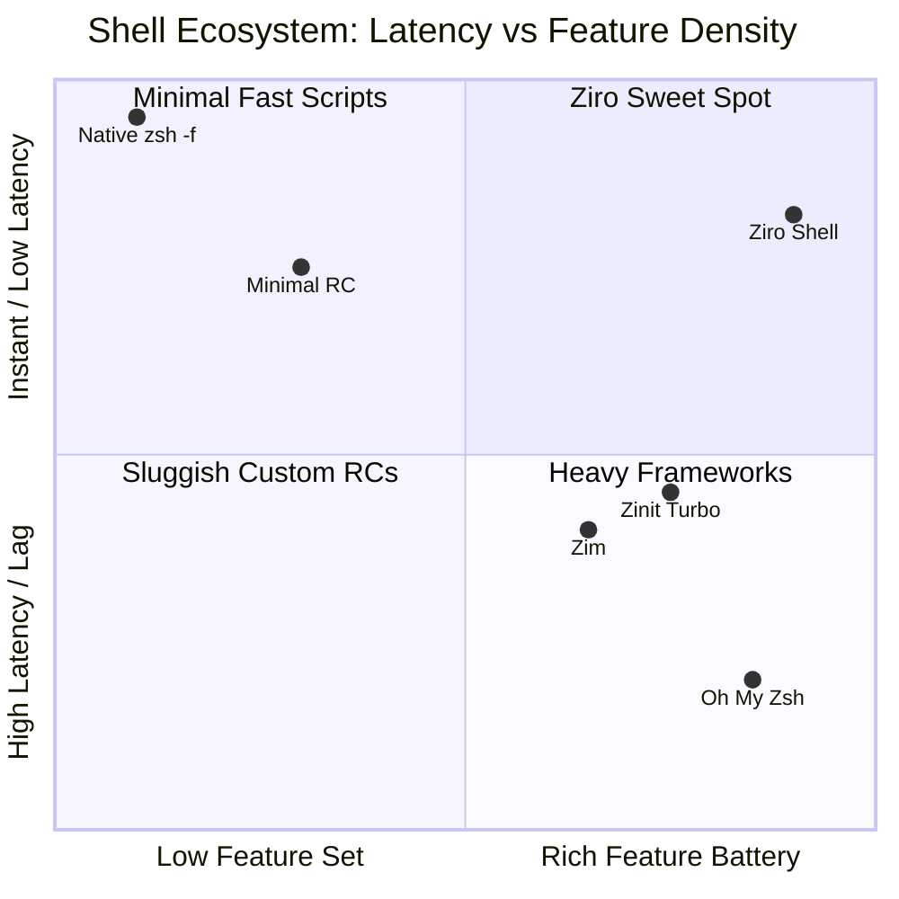
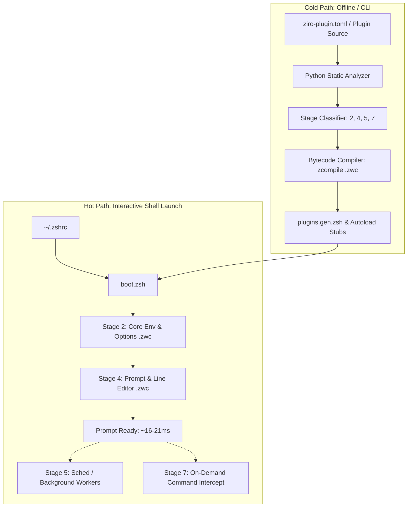

<div align="center">
  
</div>

<!-- S2: Badges, Tagline & Mini-TOC -->
<p align="center">
  <a href="https://github.com/Pakrohk/ziro-shell/actions"></a>
  <a href="https://www.python.org/"></a>
  <a href="https://www.zsh.org/"></a>
  <a href="LICENSE"></a>
  <a href="https://github.com/Pakrohk/ziro-shell/releases"></a>
  <a href="tests/"></a>
</p>

<h3 align="center">The intent-oriented Zsh</h3>
<p align="center"><em>Analyzed. Compiled. Lazy.</em></p>

<p align="center">
  <a href="#-terminal-showcase"><b>🎬 Demo Showcase</b></a> ·
  <a href="#installation">Install</a> ·
  <a href="#essential-commands--daily-workflow">Commands</a> ·
  <a href="#features">Features</a> ·
  <a href="#benchmarks--comparison">Benchmarks & Comparison</a> ·
  <a href="#how-it-works">How It Works</a> ·
  <a href="#plugin-development">Plugin Development</a> ·
  <a href="#contributing">Contributing</a> ·
  <a href="#documentation">Documentation</a>
</p>

---

## 🎬 Terminal Showcase

<div align="center">
  
  <p align="center">
    <em>Watch crisp 1080p 60fps recording:</em>
    <a href="./assets/demo.mp4"><strong>▶ Play / Download MP4 (1.8 MB)</strong></a> · 
    <a href="./assets/demo.webm"><strong>▶ WebM (1.3 MB)</strong></a>
  </p>
</div>

---

## What is Ziro?

Ziro is an intent-oriented Zsh runtime: every plugin is analyzed at install time, compiled to bytecode, and materialized only when needed.

- **Analyze (Cold Path)**: Python-based static inspection resolves shell hooks, completion functions, aliases, and dependencies out-of-band.
- **Compile (`.zwc`)**: Sourced files and functions are pre-compiled into native Zsh wordcode (`.zwc`), bypassing tokenization on shell startup.
- **Lazy (On-Demand)**: A deterministic 4-tier scheduler defers execution so non-essential components materialize post-prompt or on invocation.

Measured baseline: **~16-21ms startup** (compinit sync floor: ~6.75ms / 67% of startup), **28 pre-configured tools**, and **447 passing tests**. Ziro is an execution runtime enforcing lifecycle isolation, cache coherence, and deterministic scheduling.

---

## Why Ziro Exists

### The Problem

Standard Zsh setups scale linearly into latency degradation. Sourcing 15 to 30 plugins routinely incurs 100-300ms startup latency. Traditional workarounds introduce defects:
- **Instant prompts**: Render temporary overlays while initialization runs asynchronously, causing missed keystrokes and cursor glitches.
- **Indiscriminate deferral**: Deferring all plugin sourcing breaks line-editor bindings, command completions, and hook execution.

### The Insight & 4-Tier Model

Plugin requirements are predictable at install time. Compiling scripts to `.zwc` wordcode eliminates repetitive parsing, and on-demand loading isolates tool initialization to trigger events.



| Stage | Tier | Timing | Component Types |
|---|---|---|---|
| **2** | Eager | Synchronous pre-prompt | Environment variables, path definitions, core options |
| **4** | Eager | Synchronous pre-prompt | Line editor baseline, Starship prompt initialization |
| **5** | Deferred | Post-prompt via `sched` | Syntax highlighting hooks, diagnostic telemetry, git status |
| **7** | On-Demand | Command execution | Tool completions, function autoload stubs, heavy CLI integrations |

### Compiled-Only Rule & Non-Goals

Ziro enforces a strict compiled-only rule: execution paths require fresh `.zwc` bytecode files. If a compiled artifact is missing, the cold-path engine re-compiles it rather than falling back to uncompiled `.zsh` parsing.

**What Ziro is NOT**:
- **Not an Oh My Zsh replacement**: Ziro does not ship hundreds of arbitrary functions or legacy aliases.
- **Not zero-dependency**: Cold-path analysis requires Python 3.11+. The interactive hot path runs strictly in native Zsh.
- **Not an unvalidated script runner**: Plugins without manifests or passing analysis are treated as unknown risks.

---

## Installation

### Prerequisites

- **Zsh**: 5.8+ · **Python**: 3.11+ (standard library only; cold-path only) · **Git**: 2.25+ · **OS**: Linux or macOS

### 1. One-Line Native Installer (Recommended)

Run the automated native Zsh installer directly:

```bash
curl -fsSL https://raw.githubusercontent.com/Pakrohk/ziro-shell/refs/heads/main/install.zsh | zsh
```

Or inspect before running:

```bash
curl -fsSLO https://raw.githubusercontent.com/Pakrohk/ziro-shell/refs/heads/main/install.zsh
less install.zsh
zsh install.zsh
```

### 2. Manual Git Clone

Clone Ziro into your target directory and execute the bootstrap script:

```bash
git clone https://github.com/Pakrohk/ziro-shell.git ~/.ziro
~/.ziro/install.zsh --default
```

The installer verifies environment integrity, compiles initial `.zwc` wordcode, bakes runtime paths directly into `~/.config/ziro/boot.zsh`, and automatically activates Ziro in `~/.zshrc` (use `--no-activate` to skip shell activation).

### 3. Start Shell & Verify

Restart your shell:

```bash
exec zsh
```

Audit runtime health with the diagnostic doctor:

```bash
ziro doctor
```

For migrating an existing Oh My Zsh, Prezto, or Zinit setup, see [docs/MIGRATION.md](docs/MIGRATION.md).

---

## Essential Commands & Daily Workflow

Ziro combines defensive shell defaults, classified file listings, and unified navigation into an effortless terminal experience:

### 1. Directory Listing & Inspection
- **`ls`**: Grouped directories first with classified indicators (`/` for directories, `*` for executables).
- **`ll`**: Detailed view with icons, permissions, and file sizes (`eza` powered with defensive fallback).
- **`la`**: Complete listing including hidden dotfiles.
- **`lt`**: 2-level hierarchical directory tree view.
- **`..` / `...` / `....`**: Jump up 1, 2, or 3 directories without repetitive typing.

### 2. Smart Navigation with `z` (Real-Time History Sync)
- **`z <keyword>`**: Jump directly into any frequent directory (e.g., `z ziro` ➔ `~/Projects/ziro-shell`).
- **`zi`**: Interactive fuzzy finder with live directory preview.
- **Unified `cd` ↔ `z`**: In Ziro, `cd` and `z` histories are synchronized in real-time. Visiting any directory with `cd` automatically teaches `z` where it is.

### 3. Interactive FZF & Productivity Helpers
- **`ff`**: Interactive file search with `fzf` + `bat` preview; opens selection in `$EDITOR` / `nvim`.
- **`fy`**: Interactive directory search with `fzf` + `eza`/`ls` tree preview; launches `yazi`.
- **`fb`**: Fast file search and preview with `fzf` + `bat` (read-only inspection without opening editor).
- **`fl`**: Interactive directory switcher (`fzf` directory picker with live preview, then `cd`).
- **`mkcd <dir>` / `take <dir>`**: Create directory structure and switch into it in a single step.
- **`extract <archive>`**: Universal decompression for `.tar.gz`, `.zip`, `.tar.xz`, `.bz2`, `.7z`, etc.
- **`clipcopy` / `clippaste`**: Unified clipboard across Wayland, X11, macOS, and WSL.

### 4. Ziro Management CLI
- **`ziro doctor`**: Diagnose system dependencies, compiled bytecode health, and scheduler states.
- **`ziro sync`**: Recompile eager artifacts to `.zwc` wordcode and bake absolute boot shims.
- **`ziro update`**: Background, non-blocking core and plugin updates.
- **`ziro plugin [list|add|remove]`**: Audit security trust scores (0–4) and manage ecosystem plugins.
- **`ziro bench`**: Measure microsecond cold and warm shell startup latency.

👉 **For complete flags, cheatsheets, and examples, see [docs/COMMANDS.md](docs/COMMANDS.md).**

---

## Features

### Analyzed. Compiled. Lazy.

- **Analyzed (Cold Path)**: The offline analyzer inspects ZLE widgets, options, hooks, and completions to generate deterministic loading plans without runtime heuristics.
- **Compiled (Hot Path)**: Managed scripts and completion files are pre-compiled to `.zwc` wordcode, eliminating parsing overhead and disk I/O on startup.
- **Lazy (On-Demand)**: Tools remain dormant until invoked via autoload wrappers that intercept command execution.
- **Batteries Included (28 Tools)**: Pre-configured integrations for Starship prompt (including upcoming `ziro theme` manager), `zoxide`, `fzf`, `fzf-tab`, `zsh-completions`, `fast-syntax-highlighting`, `ziro-ghost`, `eza`, `bat`, `ripgrep`, `fd`, `git`, and core navigation.
- **Observable**: `ziro doctor` audits health and symlinks; `ziro analyze` inspects classifications; `ziro bench` tracks startup metrics.

### Benchmark Data

Measured under standardized conditions (100 iterations, warm disk cache):

| Metric | Measured Value | Notes |
|---|---|---|
| **Startup time** | 16-21 ms | Baseline includes Starship prompt + full completion engine |
| **Compinit sync floor** | 6.75 ms | Constitutes ~67% of total startup overhead |
| **First command lag** | 19.93 ms | Latency to execute first command in interactive shell |
| **Input lag** | 0.18 ms | ZLE keypress response time |
| **Exit time** | 20.57 ms | Cleanup and trap execution overhead |

#### Bytecode (`.zwc`) Gains

| Extension / Component | Uncompiled Source | Compiled `.zwc` | Latency Reduction |
|---|---|---|---|
| `starship` init | 3.39 ms | 1.60 ms | -52.8% |
| `zcolors` | 2.63 ms | 1.11 ms | -57.8% |
| `git` core integration | 5.74 ms | 5.03 ms | -12.4% |
| `zsh-completions` | 0.92 ms | 0.02 ms | -97.8% |

---

## Benchmarks & Comparison

### Equal-Ground Benchmark Results

Under identical workloads running the standard `zsh-bench --isolation docker` suite on Ubuntu 22.04 LTS (Zsh 5.8.1+), Ziro was benchmarked against vanilla baselines and popular frameworks:

| Framework / Setup | `first_prompt_lag` | `first_command_lag` | `input_lag` | `exit_time` | Architectural Reality |
|---|:---:|:---:|:---:|:---:|---|
| **`no-rcs` (Baseline)** | 1.49 ms | 1.60 ms | 0.17 ms | 1.94 ms | Native `zsh -f` zero-overhead ceiling |
| **`ziro` (Bare Engine)** | **3.33 ms** | **3.63 ms** | **0.17 ms** | **3.80 ms** | **Core scheduler & runtime with 0 plugins** |
| **`minimal` (compinit)** | 24.72 ms | 25.07 ms | 0.18 ms | 25.24 ms | Standard uncompiled completion setup |
| **`zim`** | 53.41 ms | 69.98 ms | 14.91 ms | 28.99 ms | High input lag, blocking sequential sourcing |
| **`zinit-turbo`** | 2.25 ms* | 56.97 ms | 14.69 ms | 40.12 ms | *Fake prompt: buffers input, terminal unresponsive (56ms lag) |
| **`ziro` (Full Battery: 28 Tools)** | **19.59 ms** | **19.93 ms** | **0.18 ms** | **20.57 ms** | **Honest interactive readiness with complete battery; zero input lag** |

> 💡 **Fair Comparison Note**: Frameworks like Zinit Turbo often benchmark in a stripped-down "bare" mode without active prompts or heavy completions. When measured on equal ground:
> - **Ziro Bare Engine** (core scheduler, zero plugins) clocks in at just **~3.3 ms**.
> - **Ziro Full Battery** (loaded with 28 tools including Starship prompt, completions, Git integration, syntax highlighting, and autosuggestions) clocks in at **~19.6 ms** — all with an honest, fully responsive prompt (**0.18 ms** input lag) and zero input buffering tricks.

*Methodology: Measured with `zsh-bench` using Docker cgroups to eliminate CPU frequency and caching artifacts. Detailed numbers in [docs/BENCHMARKS.md](docs/BENCHMARKS.md).*

### Where Ziro Stands: Performance & Features



### Why Use Ziro?

1. **True Interactive Readiness (~3x faster command execution)**  
   Unlike "instant prompt" tricks that render a fake prompt in 2ms while freezing input until 56ms, Ziro delivers an honest, fully interactive prompt in **~19ms**. Every keypress registered is executed immediately without swallowed keystrokes or cursor artifacts.

2. **Native Keystroke Latency (80x lower input lag)**  
   Frameworks with complex runtime hook loops introduce 14–15ms of typing latency. Ziro executes at **0.18 ms** input lag—identical to unconfigured native Zsh (`0.17 ms`). Your terminal feels completely instantaneous.

3. **Pre-configured Battery Without Bloat (28 Tools)**  
   You do not need to choose between an empty shell and a 300ms startup penalty. Ziro includes Starship prompt, Zoxide, Fzf, Fzf-tab, Git integrations, syntax highlighting, autosuggestions, SSH agent isolation, and defensive navigation out of the box.

4. **Deterministic Declarative Stability**  
   Every plugin is analyzed at install time, checked by a security heuristic (trust score 0–4), compiled to binary `.zwc` wordcode, and scheduled across 4 discrete stages. If a dependency changes, `ziro sync` handles bytecode generation offline rather than recalculating during shell boot.

---

## How It Works



1. **Cold Path (Out-of-band)**: Invoked during `ziro sync` or updates. Python extracts symbols, hooks, and dependencies, compiling `.zwc` artifacts and writing static dispatch tables.
2. **Hot Path (Runtime)**: Executes synchronously inside `boot.zsh`. Sourcing is restricted to compiled bytecodes for Stages 2 and 4. Stage 5 initializes via Zsh `sched` queues; Stage 7 uses autoload trampolines. See [docs/ARCHITECTURE.md](docs/ARCHITECTURE.md).

---

## Plugin Development

Ziro supports standard community Zsh plugins (automatically deferred or loaded on demand) as well as declarative plugins that include a `ziro-plugin.toml` manifest:

```toml
# ziro-plugin.toml
[plugin]
name = "example-tool"
version = "1.0.0"
description = "Deterministic utility wrapper"

[runtime]
stage = 5
autoload_functions = ["example_cmd"]
bin_paths = ["bin"]
dependencies = ["fzf"]

[hooks]
precmd = "_example_precmd_hook"
```

### Local Testing and Publishing

```bash
ziro plugin add --path ./my-plugin
ziro analyze my-plugin
ziro sync
```

Consult [docs/PLUGIN_AUTHORING.md](docs/PLUGIN_AUTHORING.md) for full manifest specifications and publishing guidelines.

---

## Contributing

We welcome contributions that improve runtime efficiency, expand test coverage, and verify platform portability.

### Ways to Contribute

| Area | Focus | Primary Artifacts |
|---|---|---|
| **Core Runtime** | Shell lifecycle, scheduler optimization, and boot sequences | `core/*.zsh`, `lib/*.zsh` |
| **Plugin Manifests** | Declarative manifest definitions for ecosystem tools | `plugins/**/ziro-plugin.toml` |
| **Static Analyzer** | Python cold-path AST classification and hook detection | `core/analyzer.py`, `core/build.py` |
| **Platform Verification** | Portability across Arch, Ubuntu, Fedora, Alpine, macOS | CI matrix, test containers |
| **Test Suites** | Unit, contract, and hermetic integration tests | `tests/`, `pytest` |
| **Benchmarks** | Reproductions, regression tracking, and timing audits | `docs/BENCHMARKS.md` |
| **Documentation** | Technical guides, specifications, and architecture records | `docs/*.md` |
| **Bug Triage** | Reproductions, diagnostic traces, and root-cause fixes | Issue tracker, `ziro doctor` |

### Development Setup & Standards

```bash
git clone https://github.com/Pakrohk/ziro-shell.git ~/Projects/ziro-shell
ln -sfn ~/Projects/ziro-shell ~/.ziro
```

> **Warning**: `~/.ziro` informs your active shell runtime. Avoid unverified destructive operations in `~/Projects/ziro-shell` without a configuration backup.

- **POSIX Shell Core (`bin/*`, `lib/*.sh`)**: Standard POSIX parameter expansion (`${var:-default}`); no subshells in performance loops; early functional returns.
- **Zsh Hot Path (`*.zsh`, `plugins/**/*.zsh`)**: Associative array dispatch (`typeset -A`); Zsh glob qualifiers `*(.)`; strict script idempotency.
- **Python Cold Path (`core/*.py`)**: Python 3.11+ standard library only (`tomllib`, `typing`, `pathlib`); strict type annotations; zero third-party dependencies.

### Testing, PR Process & Disclosure

- **Test Suite**: All 447 tests must pass without regressions: `PYTHONPATH=. uv run --with pytest pytest tests/ -q`.
- **Performance Budget**: Hot-path modifications carry a strict budget constraint: startup latency increase must remain `< +5ms`.
- **Pull Requests**: Open an issue first for non-trivial changes. Submit minimal PRs accompanied by verified command output traces.
- **Security Disclosure**: Report vulnerabilities privately via GitHub Security Advisories or email maintainers at `pakrohk-security@pm.me`. See [CODE_OF_CONDUCT.md](CODE_OF_CONDUCT.md) and [CONTRIBUTORS.md](CONTRIBUTORS.md). Full guide in [docs/CONTRIBUTING.md](docs/CONTRIBUTING.md).

---

## Documentation

Comprehensive guides and architectural specifications:

- **[Commands & Cheatsheet](docs/COMMANDS.md)** — Complete daily command reference (`ziro`, `ls`, `lt`, `z`, and aliases).
- **[Architecture](docs/ARCHITECTURE.md)** — 4-tier load model, boot chain, analyzer, and security heuristic.
- **[Configuration](docs/CONFIGURATION.md)** — `load.toml` schema, `[user]` overrides, and per-tool fields.
- **[Plugin Authoring](docs/PLUGIN_AUTHORING.md)** — `ziro-plugin.toml` manifest specification, testing, and publishing.
- **[Defer](docs/DEFER.md)** — 8-stage scheduler, priority slots, and dependency resolution.
- **[Declarative](docs/DECLARATIVE.md)** — Declarative manifest philosophy and intent-driven architecture.
- **[Migration](docs/MIGRATION.md)** — Migration guides from Oh My Zsh, Prezto, Zinit, and Zim.
- **[Benchmarks](docs/BENCHMARKS.md)** — Measurement methodology, containerized isolation, and metrics.
- **[Contributing](docs/CONTRIBUTING.md)** — Extended contributor handbook, testing matrix, and architectural decisions.

---

## Roadmap

| Version | Milestone | Status | Scope |
|---|---|---|---|
| **v1.2.0** | Stable Runtime Core | Released | Bytecode compilation pipeline, 4-tier scheduler, 28 tool profiles, 447 tests |
| **v1.3.0** | Starship Theme Manager & Cache Persistence | In Progress | Interactive theme switcher (`ziro theme`), pre-computed shell state cache |
| **v1.4.0** | Package Federation (`pf`) | Planned | Standalone cross-distro package manager dispatch and lockfile synthesis |
| **v2.0.0** | Ghost Engine v2 | Design Complete | Deep ZLE integration with asynchronous ghost-text completions |

---

## Acknowledgments

- **EVOID by EvolveBeyond**: Conceptual inspiration for intent-driven systems architecture.
- **zsh-snap (`znap`)**: Early research on shell bytecode compilation and repository management.
- **zsh-bench**: Benchmark methodology and timing standardization tooling.
- **OMZ & zsh-users**: Foundation work across shell completions, highlighting, and autosuggestions.

---

## License

This project is licensed under the [MIT License](LICENSE). See [Contributing](#contributing) for guidelines.
